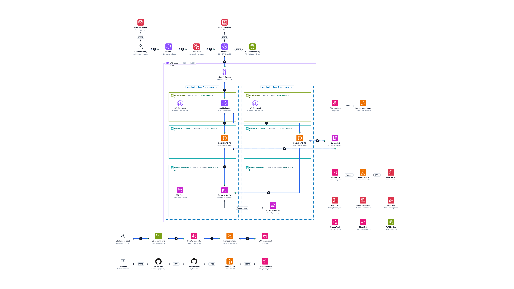

# DSO303 Assignment 2: Online Exam Platform on AWS

This repo has my architecture for moving a university's exams and assignment submissions online (8,000 students, about 400 staff).

## Summary

The platform runs in ap-south-1 across two Availability Zones.

- Students reach the site through Route 53, AWS WAF and CloudFront. The frontend is a static site in S3.
- Users sign in with Cognito. Groups decide if someone is a student, tutor or admin.
- The API runs on ECS Fargate behind a load balancer, with tasks in both AZs.
- Exam data is in Aurora PostgreSQL (writer in AZ-A, reader in AZ-B). Autosaved answers go to DynamoDB every 30 seconds.
- Assignment files go straight from the browser to S3 with a presigned URL. Lifecycle rules keep them for 5 years.
- MCQ marking and results emails run in the background with SQS and Lambda. Tutors get an email through SNS when a student uploads.
- KMS encrypts the data, Secrets Manager holds the database password, and CloudWatch handles monitoring.
- GitHub Actions and CloudFormation deploy everything from code.

If one AZ fails, the other AZ keeps the platform running and Aurora fails over to the reader.

More detail:
- Walkthroughs: [architecture/walkthroughs.md](architecture/walkthroughs.md)
- Exam peak and AZ loss: [architecture/peak-and-az.md](architecture/peak-and-az.md)
- Service table: [docs/services.md](docs/services.md)
- Cloud Architecture Lab screenshots: [evidence/](evidence/)

## Deploy

All the infrastructure is in the `infra/` folder as CloudFormation templates. You can deploy it from the AWS Console.

1. Sign in to the AWS Console and open **CloudFormation**.
2. Switch the region to **us-east-1**. Click **Create stack**, upload `infra/waf.yaml` and create it. When it finishes, copy the `WebAclArn` from the **Outputs** tab.
3. Switch the region to **ap-south-1**. Click **Create stack** and upload `infra/main.yaml`.
4. Fill in the parameters: paste the `WebAclArn`, type any long random text for `OriginVerifySecret`, and enter your email for `SenderEmail` and `AlarmEmail`.
5. Tick the box that allows CloudFormation to create IAM roles, then create the stack. It takes about 20–30 minutes.
6. When it finishes, open the `AppUrl` link from the **Outputs** tab.

**Automatic deploy (CI/CD):** the workflow in `.github/workflows/deploy.yml` does the same steps on every push to `main`. It only deploys after you connect an AWS account to the repo (using `infra/github-oidc.yaml`) and set the repo variable `DEPLOY_ENABLED` to `true`. Without that, it only checks the code.

## Tear down

1. Open **S3** and empty the three `exam-prod-...` buckets.
2. Open **RDS**, select the Aurora cluster, click **Modify** and turn off **Deletion protection**.
3. Open **DynamoDB**, select the `exam-prod-attempts` table and turn off **Deletion protection**.
4. Open **CloudFormation** in ap-south-1 and delete the `main.yaml` stack. Then delete the `waf.yaml` stack in us-east-1.
5. Some things are kept on purpose so data isn't lost by accident: the KMS key, the S3 buckets, the DynamoDB table, the backups and a final Aurora snapshot. Delete them by hand if you only deployed for testing.