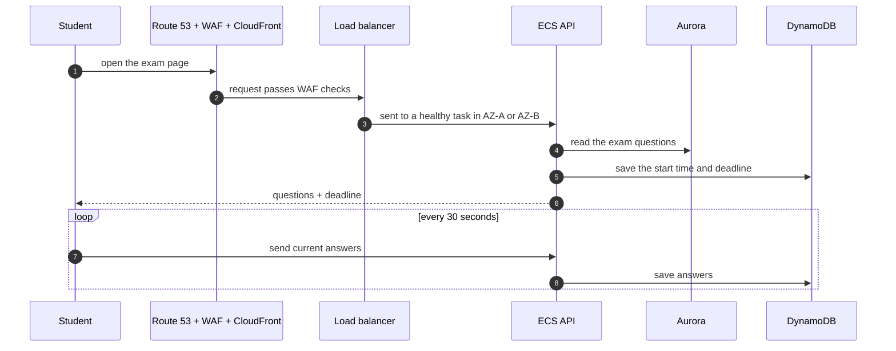
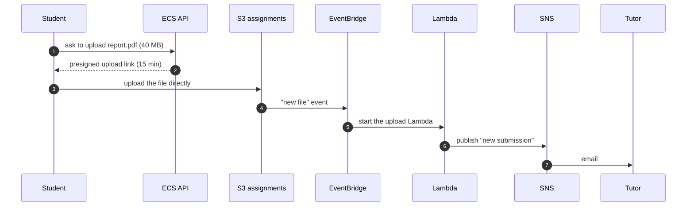

# Request walkthroughs

Diagram: [`architecture-diagram.png`](architecture-diagram.png). I built it in the Cloud Architecture Lab.

The platform runs in **ap-south-1 (Mumbai)** across two Availability Zones, AZ-A and AZ-B.

## Network

| Subnet | AZ-A | AZ-B | What runs there |
|---|---|---|---|
| Public | 10.0.0.0/19 | 10.0.32.0/19 | Load balancer, NAT Gateway |
| Private app | 10.0.64.0/19 | 10.0.96.0/19 | ECS Fargate API |
| Private data | 10.0.128.0/19 | 10.0.160.0/19 | Aurora writer (AZ-A), Aurora reader (AZ-B) |

The VPC is 10.0.0.0/16. Only the load balancer is open to the internet. The API only accepts traffic from the load balancer, and the database only accepts traffic from the API.

## Walkthrough 1: a student opens an exam and answers autosave

1. The student is already signed in with Cognito, so every request carries a login token.
2. Route 53 sends the request to CloudFront. AWS WAF checks it first and blocks attacks and floods.
3. CloudFront passes the API request through the Internet Gateway to the load balancer.
4. The load balancer sends it to a healthy ECS task in either AZ.
5. The API checks the token and the exam time, then reads the questions from Aurora.
6. The API saves the start time and deadline in DynamoDB. The server keeps the deadline, so the student can't change the timer.
7. Every 30 seconds the browser sends the answers, and the API saves them in DynamoDB. A newer save always replaces an older one.

When the student submits, the API puts a job on the SQS marking queue and a Lambda marks the MCQs.

## Walkthrough 2: a student uploads a 40 MB assignment and the tutor is notified

1. The student asks the API for an upload link. The API checks it is a PDF or ZIP, under 50 MB, and before the due date.
2. The API gives back a presigned S3 link that works for 15 minutes.
3. The browser uploads the 40 MB file straight to S3. It never goes through the API, so big uploads don't slow the exam system down.
4. S3 encrypts the file and keeps it for 5 years.
5. S3 sends a "new file" event to EventBridge, which starts a Lambda.
6. The Lambda checks the file, saves the submission record and publishes a message to SNS.
7. SNS emails the tutor.

Results emails work differently. When a tutor releases results, the API puts one message per student on an SQS queue, and a Lambda sends each email through Amazon SES.