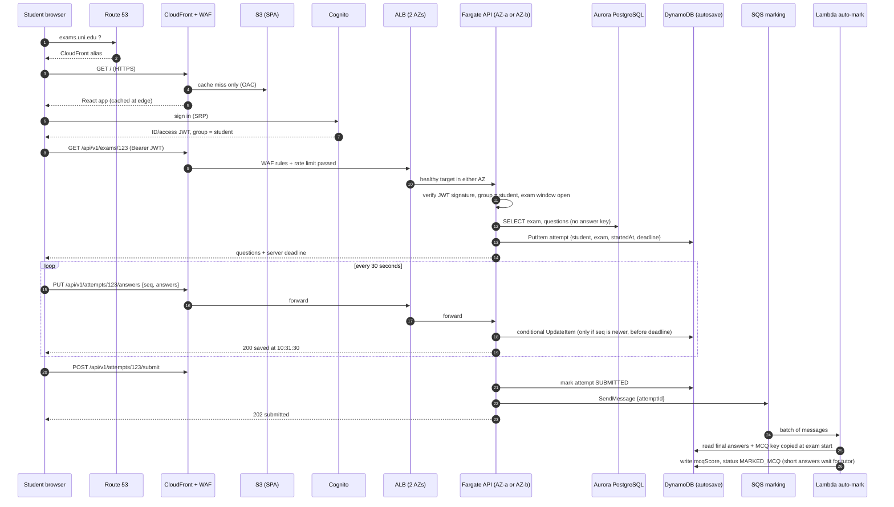
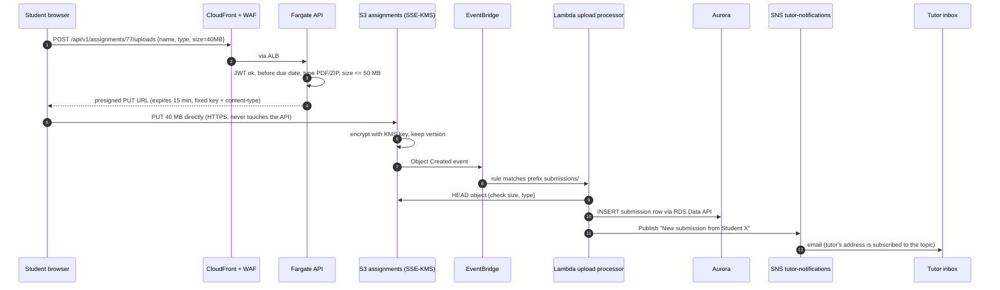

# Request walkthroughs

Diagram: [`architecture-diagram.png`](architecture-diagram.png). I built it in the Cloud Architecture Lab.
Region: **ap-south-1 (Mumbai)**, the closest AWS region to the university. Two Availability Zones: **AZ-a** and **AZ-b**.

## Network layout

| Subnet | AZ-a | AZ-b | What lives there |
|---|---|---|---|
| Public | 10.0.0.0/19 | 10.0.32.0/19 | ALB nodes, NAT Gateway (one per AZ) |
| Private app | 10.0.64.0/19 | 10.0.96.0/19 | ECS Fargate API tasks |
| Private data | 10.0.128.0/19 | 10.0.160.0/19 | Aurora PostgreSQL writer / reader |

Each subnet is a /19 with 8,187 usable addresses. Each Fargate task takes one IP, so that is plenty. It also matches how the Cloud Architecture Lab splits a /16 VPC into six equal subnets. The range 10.0.192.0/18 stays free for growth.

The security groups form a chain. `ALB-SG` accepts 443 only from the CloudFront managed prefix list. `API-SG` accepts 8080 only from `ALB-SG`. `DB-SG` accepts 5432 only from `API-SG`. The database has no public IP and no route to the Internet Gateway.

---

## Walkthrough 1: a student opens an exam and answers autosave

Step by step:
1. **DNS and edge.** Route 53 points the domain to CloudFront. WAF checks the AWS managed rules and a per-IP rate limit. CloudFront serves the SPA from its cache. On a miss, it reads the private S3 bucket through Origin Access Control.
2. **Sign-in.** Cognito signs the student in and issues a JWT. Its `cognito:groups` claim is `student`.
3. **Open exam.** `GET /api/v1/exams/123` goes CloudFront → ALB → any healthy Fargate task in AZ-a or AZ-b. The API checks the JWT, checks that the student is enrolled and that the exam window is open, then reads the exam from Aurora without the answer key. It records the attempt start in DynamoDB, together with a copy of the MCQ answer key. That way marking never has to query Aurora at peak time. The **server** sets the deadline, so nobody can cheat the timer from the browser.
4. **Autosave every 30 s.** The browser sends the current answers with a sequence number that keeps going up. The API runs a conditional `UpdateItem` in DynamoDB, so an older or late save can never overwrite a newer one. The browser also keeps a copy in local storage, so a network blip loses nothing.
5. **Submit and auto-mark.** On submit, or when the timer runs out, the API sets the status to `SUBMITTED` and puts a message on SQS. A Lambda function marks the MCQs against the stored key and writes the score on the attempt. When the tutor finishes marking the short answers, the API saves the final result to the `results` table in Aurora. A message that fails 3 times goes to a dead-letter queue.

## Walkthrough 2: a student uploads a 40 MB assignment and the tutor is notified

Step by step:
1. **Ask for an upload slot.** The browser calls `POST /api/v1/assignments/77/uploads`. The API checks the JWT, the due date, the file type (PDF or ZIP) and the size (≤ 50 MB). It returns a **presigned S3 PUT URL**. The URL works for 15 minutes and only for one object key and content type.
2. **Direct upload.** The browser PUTs the 40 MB file straight to S3 over HTTPS. The file never passes through CloudFront, the ALB or the containers, so big uploads can't tie up the API during exam week.
3. **Stored safely.** S3 encrypts the object with the KMS key and keeps every version. Lifecycle rules move it to cheaper storage over time and delete it after 5 years.
4. **Event-driven processing.** S3 sends an *Object Created* event to EventBridge. A rule triggers the upload-processor Lambda. The Lambda checks the object and writes a submission row in Aurora.
5. **Tutor notified.** The Lambda publishes a message to the **SNS topic `tutor-notifications`**. The tutor's email address subscribes to the topic, so SNS emails them straight away. SNS retries delivery itself, so this small, one-per-upload message needs no extra queue.

**Results released (the other email feature).** When a tutor releases results, the API puts one message per student on the **SQS results-email queue**. A Lambda sends each email through **Amazon SES**. I use SQS here because one release can create hundreds of emails at once. The queue absorbs the burst and retries any failures through a DLQ.
